# DEPI Graduation Project — Complete Technical Walkthrough & Instructor Preparation

**Repository:** `/home/hamza/Projects/financial-market-data-pipeline`  
**Generated:** 2026-10-28  
**Date Updated:** Wed Nov 04 2026  
**Read-only investigation - No files modified**

---

## 1) Executive Summary

This is a **batch ETL (Extract → Transform → Load)** pipeline for daily OHLCV (Open/High/Low/Close/Volume) equity market data. The stated goal (from `docs/01_project_proposal.md:12-28`) is to automate retrieval, validation, cleaning, transformation (returns/SMAs/volumes/volatility), storage in PostgreSQL (separating raw and transformed data), orchestration with Apache Airflow, analytical SQL, and a data-quality report/visualizations.

**Key evidence:**
- Problem/approach: `docs/01_project_proposal.md:10-88`
- Architecture: `docs/08_system_analysis_and_design.md:18-273`, `README.md:90-122`
- Implementation: `pipeline.py:1-149`, `ingestion/`, `transform/`, `database/`, `dags/financial_pipeline_dag.py`, `config/settings.py`, `utils/logger.py`

**Current reality:** The codebase contains substantial implementation (ingestion with validation/retry/incremental, cleaning/calculations, loader with idempotent upserts, schema with constraints/indexes/views/analytics SQL, Airflow DAG, tests). However, **no runtime evidence** (no populated DB, no Airflow running, no successful end-to-end run against live DB/API) exists in the repo. The most recent fix addresses P0 extraction failure propagation; no-new-data is now treated as a legitimate success path.

---

## 2) Actual Project Phase and Progress Table

Based on `Financial Pipeline — Project Plan.html` (Phases 0-2), `docs/02_project_plan.md` (milestones M0-M8), codebase inspection, and git history (`05f3513 Prepare financial market data pipeline phases 0-2`, `9873df8 Initial commit`).

| Phase / Component | Purpose | Actual implementation | Evidence | Status | Remaining work |
|---|---|---|---|---|---|
| **Phase 0: Kickoff & Setup** | Repo, team, env, proposal, board, meetings | Repo exists with structure, `.env.example`, `requirements.txt`, `README.md`, `docs/` pack. Team listed. | `.git/`, `origin https://github.com/ibrahimhamzza/financial-market-data-pipeline.git`, `README.md:10-16`, `docs/01_project_proposal.md:5,95-99`, `docs/03_task_assignment_and_roles.md:7-12` | **Partially implemented** (Requires external confirmation) | Prove DEPI registration, collaborators added, proposal submitted/PDF, shared task board, weekly sync meetings. No local evidence. |
| **Phase 1: Research & Architecture Design** | Architecture, stack, config, logging, API research, schema/ERD | Architecture in Mermaid/ASCII, stack chosen, `config/settings.py`, `utils/logger.py`, `docs/09_api_research.md`, `database/schema.sql` with indexes, ERD in Mermaid. | `docs/08_system_analysis_and_design.md:18-273`, `README.md:90-139`, `config/settings.py:1-73`, `utils/logger.py:1-34`, `docs/09_api_research.md:1-100`, `database/schema.sql:1-58` | **Partially implemented** | Export architecture diagram and ERD as images (`.png/.svg/.drawio`); manual API testing evidence missing. No diagrams found outside venv. |
| **Phase 2: Data Ingestion Module** | API client, validation, retry, extractor, incremental, raw storage, DB connector/loader | Full implementation with validation, retry (exponential backoff), yfinance/Alpha Vantage, raw JSON saving, incremental watermark, idempotent loader, schema. | `ingestion/api_client.py:1-247`, `ingestion/extractor.py:1-120`, `ingestion/incremental.py:1-47`, `database/db_connector.py:1-28`, `database/loader.py:1-192`, `database/schema.sql:1-58`, `raw_data/.gitkeep` | **Implemented in code but not verified end-to-end** | Schema application not proven locally; need actual DB run; recent fix addresses P0 but runtime verification needed. |
| **Phase 3: Transformation & Metrics** | Cleaner, calculator, transformed table | Implemented. | `transform/cleaner.py:1-68`, `transform/calculator.py:1-59`, `transform/staged_metrics.py:1-100`, `database/schema.sql:18-33` (transformed table) | **Implemented in code but not verified end-to-end** | Needs real data + DB to verify calculations end-to-end. |
| **Phase 4: SQL Analytics & Incremental** | Analytics SQL, views, indexes, pipeline_runs | Implemented. | `database/analytics.sql:1-125`, `database/views.sql:1-37`, `database/schema.sql:35-58`, `ingestion/incremental.py:1-47`, `database/loader.py:144-192` | **Implemented in code but not verified end-to-end** | SQL not executed against populated DB. |
| **Phase 5: Airflow Orchestration** | DAG, tasks, scheduling, retries | Implemented. | `dags/financial_pipeline_dag.py:1-48`, `pipeline.py:1-149` | **Implemented in code but not verified end-to-end** | Airflow not running; no UI screenshots/logs in repo. |
| **Phase 6: Testing, Quality, Viz** | Tests, quality checks, notebooks | Tests exist and pass offline; quality checks implemented (queries DB); notebooks present. | `tests/*.py` (7 files), `transform/quality.py:1-56`, `notebooks/` exists | **Partially implemented / Implemented in code but not verified end-to-end** | Quality checks require DB; notebooks may not have executed outputs shown. |
| **Phase 7: Docs & Presentation** | README, diagrams, slides | Extensive docs; diagrams only Mermaid. | `README.md`, `docs/`, no exported diagram images outside venv | **Partially implemented** | Export diagrams, prepare DEPI PPT/final PDF/ZIP, rehearsal. |

**Actual current phase:** **Between Phase 2-5 (Implementation)** - core modules are written, but **no end-to-end run against real DB/API has been demonstrated by repo evidence**. Tests pass offline with mocks. This is "implemented in code but not verified end-to-end" overall.

---

## 3) Data Source and Extraction

### Answers

1. **Where does data come from?** Financial market data APIs (REST) - `docs/01_project_proposal.md:54`, `docs/09_api_research.md:1-7`.
2. **Which API/service?** Supports **Alpha Vantage** (`TIME_SERIES_DAILY`) and **yfinance**. See `ingestion/api_client.py:29,194-215,100-156`, `docs/09_api_research.md:10-73`.
3. **Type of data:** Daily OHLCV (Open, High, Low, Close, Volume) for equities - `README.md:112-114`, `ingestion/api_client.py:27`, `docs/09_api_research.md:20-46`.
4. **Symbols/tickers:** Configured via `SYMBOLS` env var, default `AAPL,MSFT,GOOGL,AMZN,META,TSLA,NVDA,JPM` - `config/settings.py:45`, `README.md:210-212`, `docs/01_project_proposal.md:35`.
5. **Extraction frequency/date range:** Orchestrated daily on weekdays at 22:00 UTC (`schedule="0 22 * * 1-5"`, `dags/financial_pipeline_dag.py:37`). Incremental extraction uses watermark (last loaded date per symbol) - `ingestion/incremental.py:17-47`, `ingestion/extractor.py:31-37`. Date range depends on API/source and incremental state; Alpha Vantage `compact` ~last 100 sessions, `full` = full history (`docs/09_api_research.md:57`).
6. **Intended vs runtime default:** `docs/09_api_research.md:6,97-100` says yfinance default for dev, Alpha Vantage for official API requirement. **Runtime default:** `config/settings.py:42` sets `DATA_SOURCE = (_env("DATA_SOURCE", "yfinance") or "yfinance").lower()` - so **yfinance is the actual runtime default**. Alpha Vantage is intended for official demonstration per docs.
7. **Live/historical/batch/streaming:** **Batch-based** extraction. No streaming/websocket code. Daily scheduled batch via Airflow. Not real-time streaming.
8. **One extracted record contains:** Standardized OHLCV - `symbol`, `trade_date`, `open_price`, `high_price`, `low_price`, `close_price`, `volume` - `ingestion/api_client.py:54-66`, `README.md:218-230`.
9. **Representation before/after extraction:** Before - vendor JSON (Alpha Vantage nested dict with date keys and numbered fields, or yfinance DataFrame with Date/Open/High/Low/Close/Volume). After - pandas DataFrame with standardized columns, numeric types, sorted by date, UTC-naive dates, volume as Int64 - `ingestion/api_client.py:54-191`.
10. **Raw data storage:** Saved as timestamped JSON files to `RAW_DATA_DIR` (default `raw_data/`) via `save_raw_json()` - `ingestion/api_client.py:68-77,154,211`, `config/settings.py:48-50`, `raw_data/.gitkeep`. Also stored in `raw_market_data` table.
11. **Failures/rate limits/missing/duplicates/incremental:** HTTP validation checks status/non-empty/JSON - `api_client.py:39-51`. Payload validation checks error keys and required fields - `api_client.py:159-191`. Retries with exponential backoff (max 3, base delay 1s) on connection/timeout/APIClientError - `api_client.py:79-97`. Per-symbol errors logged and collected; all/partial failures now raise `ExtractionError` (P0 fixed) - `ingestion/extractor.py:44-74,77-120`. Duplicates prevented by DB unique constraint `(symbol,trade_date)` and `ON CONFLICT DO NOTHING` - `database/schema.sql:14`, `database/loader.py:87`. Incremental uses watermark from `raw_market_data` - `ingestion/incremental.py:17-47`.
12. **No new data:** Returns empty DataFrame with `attrs["no_new_data"]=True` from `run_extraction()` - `ingestion/extractor.py:77-104`. `extract_task()` returns `"NO_NEW_DATA"`, removes stale staging/metrics, `run_pipeline()` records success with `no_new_data: true` and skips transform/load - `pipeline.py:29-149`.
13. **Credentials:** Alpha Vantage API key required if using `alphavantage` source - `config/settings.py:40,67-72`. Loaded from `.env` via `python-dotenv` - `config/settings.py:9-13`. `.env.example:10` shows placeholder. No secrets committed (`.gitignore` includes `.env`).

**Key functions/paths:** `ingestion/api_client.py:39,54,68,79,100,158,194,217,238`; `ingestion/extractor.py:31`; `ingestion/incremental.py:17,42`; `config/settings.py:15,22,30,34-56,58,67`.

---

## 4) System Architecture and End-to-End Workflow

### Mermaid Flowchart (Implemented)

```mermaid
flowchart LR
    ENV[".env / config/settings.py"] --> CFG
    CFG["config/settings.py\nSYMBOLS/DATA_SOURCE/DB"] --> API
    API["ingestion/api_client.py\nfetch_daily/validate/retry/save_raw_json"] --> EXT
    INC["ingestion/incremental.py\nget_last_loaded_date/next_start_date"] --> EXT
    EXT["ingestion/extractor.py\nrun_extraction (symbols loop)"] --> PIPE
    PIPE["pipeline.py\nextract/validate/transform/load/quality_check"] --> STG
    STG["raw_data/_staging.csv"] --> CLN
    CLN["transform/cleaner.py"] --> CALC
    CALC["transform/calculator.py"] --> STM
    STM["transform/staged_metrics.py\nuses history + staging"] --> MET
    MET["raw_data/_metrics.csv"] --> LDR
    LDR["database/loader.py\nload_raw (ON CONFLICT DO NOTHING)\nload_transformed (UPSERT)"] --> PG
    DBC["database/db_connector.py\nSQLAlchemy engine"] --> LDR
    PG[(PostgreSQL\nraw_market_data\ntransformed_market_data\npipeline_runs)] --> QA
    QA["transform/quality.py\nrun_quality_checks"] --> PG
    PG --> ANA["database/analytics.sql / views.sql"]
    AF["dags/financial_pipeline_dag.py\n5 tasks + deps"] --> PIPE
```

### Step-by-step (implemented)

| Step | Input | What happens | Output | File/Function | Next | Failure modes |
|---|---|---|---|---|---|---|
| Config load | `.env` | `load_dotenv`, parse env vars, build DB URL | Settings/constants | `config/settings.py:12,15-65` | All modules | Missing required vars raise RuntimeError |
| Logging setup | Settings | Create root logger `financial_pipeline` with stream+file handlers | Logger | `utils/logger.py:15-34` | All modules | File permission issues (logged) |
| Orchestration | Airflow scheduler/time | DAG triggers tasks in order | Task execution | `dags/financial_pipeline_dag.py:32-48` | extract_task | Task failures/retries per DAG defaults |
| Extract | Symbols, incremental flag | Get watermarks, fetch per symbol via API client, collect frames or raise `ExtractionError`/return no-new-data | DataFrame or exception/NO_NEW_DATA | `ingestion/extractor.py:31-120`, `pipeline.py:29-52` | validate or pipeline short-circuit | API errors, all/partial failures → `ExtractionError`; no errors+no rows → no-new-data |
| Validate | Staging CSV | Check existence, required columns, nulls | Validated CSV or skip/exception | `pipeline.py:54-76` | transform or skip | Missing/stale file, bad schema, nulls → exceptions |
| Transform | Staging + history | Clean, compute metrics using full history for windows/cumulative | Metrics CSV | `transform/cleaner.py:28-68`, `transform/calculator.py:12-59`, `transform/staged_metrics.py:70-100`, `pipeline.py:78-87` | load or skip | Missing columns, bad data → exceptions |
| Load | Staging + metrics | Insert raw with `ON CONFLICT DO NOTHING`, upsert transformed | DB rows | `database/loader.py:73-141`, `pipeline.py:89-96` | quality or skip | DB errors, constraint violations → exceptions |
| Quality check | DB state | Run checks, raise if duplicates/orphans | Quality dict or exception | `transform/quality.py:13-56`, `pipeline.py:98-100` | done or fail | Quality violations raise ValueError |
| Audit | Pipeline run | Record start/finish in `pipeline_runs` | Audit row | `database/loader.py:144-192`, `pipeline.py:102-149` | — | DB errors logged/wrapped |

**Distinction:** Mermaid in `docs/08_system_analysis_and_design.md` shows similar flow; implemented matches with additions (no-new-data handling, P0 fixes, staged metrics).

---

## 5) Technologies and Tools

| Technology | What it is | Why we use it | Role in project | Evidence | Status |
|---|---|---|---|---|---|
| **Python 3.10+** | Programming language | Core logic, ETL, orchestration integration | All modules | `requirements.txt:1`, `README.md:130` | Implemented (code uses it) |
| **pandas** | Data manipulation | Parse/clean/transform OHLCV, rolling calcs | Ingestion/transform/loader/pipeline | `requirements.txt:3`, `ingestion/api_client.py:11`, `transform/*` | Implemented |
| **numpy** | Numerical computing | Used implicitly/by pandas; listed | Data processing | `requirements.txt:4` | Configured/used via deps |
| **requests** | HTTP client | Call APIs | API client | `requirements.txt:5`, `ingestion/api_client.py:12,205` | Implemented |
| **python-dotenv** | Env loader | Load `.env` | Config | `requirements.txt:6`, `config/settings.py:9-13` | Implemented |
| **yfinance** | Yahoo Finance client | Dev data source | API client | `requirements.txt:9`, `ingestion/api_client.py:105,123` | Implemented |
| **alpha-vantage** | Alpha Vantage client (listed) | Official API option | Listed but code uses `requests` directly | `requirements.txt:10`, `ingestion/api_client.py:29,194-215` | Configured/listed (code uses requests directly) |
| **SQLAlchemy** | ORM/SQL toolkit | DB engine, queries | DB layer | `requirements.txt:14` (1.4.52 for Airflow compat), `database/db_connector.py:7-11`, `database/loader.py:8-12` | Implemented |
| **psycopg2-binary** | PostgreSQL driver | DB connectivity | SQLAlchemy driver | `requirements.txt:15` | Implemented |
| **Apache Airflow** | Workflow orchestrator | Schedule DAG, retries, dependencies | DAG | `requirements.txt:18`, `dags/financial_pipeline_dag.py:13-15` | Implemented in code, **not verified running** |
| **python-dateutil** | Date utilities | Listed as dependency | Listed | `requirements.txt:19` | Configured |
| **matplotlib** | Plotting | Viz (planned) | Listed/notebooks | `requirements.txt:22`, `README.md:135` | Configured (notebooks exist) |
| **plotly** | Interactive plotting | Viz (planned) | Listed/notebooks | `requirements.txt:23`, `README.md:135` | Configured |
| **jupyter/notebook** | Notebooks | Analysis/reporting | `notebooks/` exists | `requirements.txt:24-25` | Configured |
| **pytest/pytest-cov** | Testing | Unit tests | `tests/` | `requirements.txt:28-29` | Implemented (offline tests pass) |
| **PostgreSQL** | Relational DB | Store raw/transformed/audit | Schema/loader/quality | `README.md:133`, `database/schema.sql` | Implemented in code, **not verified running/populated** |
| **Git/GitHub** | VCS | Collaboration | `.git/`, remote | `.git/`, `git remote -v` | Implemented |
| **Docker/Docker Compose** | Containerization | Optional extension | `docker-compose.yml` exists in listing | `README.md:84`, `README.md:138` (optional) | **Configured/listed, not verified operational** |
| **MongoDB** | NoSQL | Optional raw JSON store | Listed as optional | `requirements.txt:31` commented, `README.md:88` | **Planned only** |
| **Logging** | Observability | Centralized logging | `utils/logger.py` | Used throughout | Implemented |

**Note:** Presence in `requirements.txt`/docs does not mean operational - only code usage proves implementation.

---

## 6) Database and Data Modeling

### Tables (from `database/schema.sql:1-58`)

| Table | Purpose | Key columns (types) | Constraints/Indexes |
|---|---|---|---|
| **`raw_market_data`** | Raw OHLCV from vendor | `id` SERIAL PK, `symbol` VARCHAR(10) NOT NULL, `trade_date` DATE NOT NULL, `open_price`/`high_price`/`low_price`/`close_price` NUMERIC(12,4) NOT NULL, `volume` BIGINT NOT NULL CHECK(volume>=0), `loaded_at` TIMESTAMP DEFAULT NOW() | `UNIQUE(symbol,trade_date)`, `CHECK(high_price>=low_price)`, indexes `idx_raw_symbol_date`, `idx_raw_symbol_date_close` |
| **`transformed_market_data`** | Calculated metrics | `id` SERIAL PK, `symbol` VARCHAR(10) NOT NULL, `trade_date` DATE NOT NULL, `close_price` NUMERIC(12,4) NOT NULL, `daily_return` NUMERIC(10,6), `ma_7/ma_20/ma_50` NUMERIC(12,4), `avg_volume_7d` NUMERIC(20,2), `volume_ratio` NUMERIC(10,4), `cumulative_return` NUMERIC(10,6), `volatility_20d` NUMERIC(10,6), `loaded_at` TIMESTAMP DEFAULT NOW() | `UNIQUE(symbol,trade_date)`, indexes `idx_transformed_symbol_date`, `idx_transformed_symbol_date_close` |
| **`pipeline_runs`** | Audit log | `id` SERIAL PK, `run_date` TIMESTAMP DEFAULT NOW(), `status` VARCHAR(20) CHECK(status IN ('success','failed','running')), `symbols_processed` INTEGER, `rows_inserted` INTEGER, `duration_seconds` NUMERIC(12,3), `error_message` TEXT | Index `idx_pipeline_runs_date DESC` |

**Views:** `v_latest_prices`, `v_top_gainers`, `v_volume_spikes` in `database/views.sql:1-37`. **Analytics:** `database/analytics.sql:1-125` has window functions/CTEs.

### How it works

- **Duplicates:** Prevented by `UNIQUE(symbol,trade_date)`. `load_raw()` uses `INSERT ... ON CONFLICT (symbol,trade_date) DO NOTHING` (`database/loader.py:73-95`). `load_transformed()` uses `UPSERT ... ON CONFLICT DO UPDATE SET ... loaded_at=NOW()` (`database/loader.py:97-133`).
- **Incremental loading:** `ingestion/incremental.py:17-47` queries `MAX(trade_date)` per symbol from `raw_market_data`; `next_start_date()` returns `last_date + 1 day`. `extractor.py:31-37` passes it to `fetch_daily()`. Alpha Vantage fetches full/paginated by params (code filters by date after fetch for Alpha Vantage path `api_client.py:226-233`); yfinance uses start/end.
- **Idempotency:** Raw inserts skip conflicts (idempotent re-runs won't duplicate). Transformed upserts refresh metrics on conflict. Running twice shouldn't create duplicates due to constraints + conflict handling.
- **Pipeline history:** `start_pipeline_run()` inserts with status `running` (`loader.py:144-157`), `finish_pipeline_run()` updates status/symbols/rows/duration/error (`loader.py:159-192`). `run_pipeline()` uses this with try/except (`pipeline.py:102-149`).
- **Layers:** Raw JSON in `raw_data/` (landing), staging CSV in `raw_data/_staging.csv` (transient), `raw_market_data` table (raw structured), `transformed_market_data` table (curated metrics). No separate "final" layer beyond transformed tables/views.

### Example record flow (hypothetical)
1. Extract: `fetch_daily('AAPL')` returns DataFrame with `symbol='AAPL', trade_date=2024-01-02, open_price=100.0, high_price=110.0, low_price=90.0, close_price=105.0, volume=1000` (standardized by `api_client.py:54-66`).
2. Saved as `raw_data/AAPL_20240102T...Z.json` (`api_client.py:68-77`).
3. Written to `raw_data/_staging.csv` by `extract_task()` (`pipeline.py:49`).
4. Cleaned/validated by `cleaner.py` (types, dedup, forward-fill) → passed to `staged_metrics.py` which combines with history and calls `calculator.py` for metrics.
5. `load_raw()` inserts into `raw_market_data` with `ON CONFLICT DO NOTHING` (`loader.py:81-95`).
6. `load_transformed()` upserts into `transformed_market_data` with metrics (`loader.py:106-133`).

---

## 7) Transformations, Validation, and Data Quality

### Transformations (`transform/`)
- **Cleaner** (`cleaner.py:28-68`): renames columns via `COLUMN_MAP`, uppercases symbols, converts dates to naive datetimes, coerces prices/volume to numeric, sorts by symbol/date, forward-fills prices within symbol (`groupby.ffill()`), drops duplicates keeping last, drops rows with NaN close/symbol/date, fills volume NaN with 0 (clipped >=0, int64), drops rows where high < low, resets index.
- **Calculator** (`calculator.py:12-59`): per-symbol groups sorted by date; `daily_return = close.pct_change()`, `ma_7/ma_20/ma_50` via `rolling().mean()` with `min_periods` = window size, `avg_volume_7d = volume.rolling(7,min_periods=7).mean()`, `volume_ratio = volume/avg_volume_7d`, `cumulative_return = (1+daily_return.fillna(0)).cumprod()-1`, `volatility_20d = daily_return.rolling(20,min_periods=20).std()`, `max_drawdown = cumulative_return - cumulative_return.cummax()`. Early windows remain NaN.
- **Staged metrics** (`staged_metrics.py:70-100`): combines history + staging (history first, staging last, drop duplicates keep last), cleans, calculates metrics on full combined history, then filters to only staging keys (ensures correct cumulative/rolling windows).

### Validation
- **API/HTTP**: `api_client.validate_http_response()` checks status 200, non-empty body, valid JSON (`api_client.py:39-51`).
- **Payload**: Alpha Vantage checks for error keys, requires `Time Series (Daily)`, validates each bar fields; yfinance checks required columns (`api_client.py:148-191`). Raises `APIClientError`/`PayloadValidationError`.
- **Pipeline validation**: `validate_task()` checks staging exists, required columns present, no null symbol/trade_date; empty DataFrame raises `ValueError` (`pipeline.py:54-76`).
- **Retries**: exponential backoff up to 3 attempts on connection/timeout/API errors (`api_client.py:79-97`).

### Data Quality
- **Quality checks** (`transform/quality.py:13-56`): queries DB for row counts, distinct symbols, duplicates in raw (group by symbol/trade_date having count>1), null close prices, orphan transformed (no matching raw). Raises `ValueError` if duplicates > 0 or orphans > 0. Used by `quality_check_task()`.
- **Storage**: Quality results returned as dict from `run_quality_checks()`, logged; not written to a separate quality table (only logged/raised).

### What happens on failure / unhandled cases
- **Validation failure**: exceptions raised, `run_pipeline()` catches, records `pipeline_runs` status `failed` with error message, re-raises (`pipeline.py:129-144`).
- **Bad records**: Cleaner drops rows with NaN close after ffill, drops high<low rows (logged). API validation rejects bad payloads. Duplicates handled by constraints/conflicts.
- **Potential issues**: `quality_check_task()` requires DB connection (will fail if DB down). `run_quality_checks()` raises on quality violations (fails pipeline). No-new-data is now handled as success. Partial extraction failures raise `ExtractionError` (fixed). Some cases (e.g., all symbols return empty with no errors) now treated as no-new-data success.

---

## 8) Airflow and Orchestration

### What is Airflow?
Apache Airflow is a workflow orchestration platform for scheduling and monitoring DAGs (Directed Acyclic Graphs) of tasks with dependencies, retries, and logging. Here used to schedule batch ETL runs.

### DAG (`dags/financial_pipeline_dag.py:1-48`)
- **DAG ID:** `financial_pipeline_dag`
- **Schedule:** `schedule="0 22 * * 1-5"` (weekdays at 22:00 UTC) - `line 37`
- **Start date:** `datetime(2026, 10, 26)` - `line 36`
- **Catchup:** `False` - `line 38`
- **Max active runs:** `1` - `line 39`
- **Default args:** `retries=3`, `retry_delay=timedelta(minutes=5)`, `owner="depi-financial-pipeline"`, `depends_on_past=False` - `lines 24-30`
- **Tasks:** `extract`, `validate`, `transform`, `load`, `quality_check` (PythonOperators calling functions from `pipeline.py`) - `lines 42-46`
- **Dependencies:** `extract >> validate >> transform >> load >> quality_check` - `line 48`

### Task mapping
- `extract` → `pipeline.extract_task()` (`pipeline.py:29-52`)
- `validate` → `pipeline.validate_task()` (`pipeline.py:54-76`)
- `transform` → `pipeline.transform_task()` (`pipeline.py:78-87`)
- `load` → `pipeline.load_task()` (`pipeline.py:89-96`)
- `quality_check` → `pipeline.quality_check_task()` (`pipeline.py:98-100`)

### No-new-data handling
- `extract_task()` detects `attrs["no_new_data"]` from `run_extraction()`, removes stale staging/metrics, returns `"NO_NEW_DATA"` (success) - `pipeline.py:35-52`.
- Downstream tasks skip gracefully when no staging exists (return skip markers/0/skip dict) for DAG compatibility - `pipeline.py:54-100`.
- `run_pipeline()` short-circuits on no-new-data, records `pipeline_runs` status `success` with `no_new_data: true` (uses existing status constraint) - `pipeline.py:113-128`.

### Operational status
**Not verified operational.** DAG is defined, but Airflow not running in repo evidence (no `airflow_home/` logs showing runs, no screenshots). Requires Airflow installation/setup per `README.md:176-191`.

---

## 9) Testing and Verification Results

### Test files (`tests/`)
| File | Coverage |
|---|---|
| `tests/test_api_client.py` | HTTP validation, Alpha Vantage parsing, error cases (note/rate limit) - uses fakes/mocks |
| `tests/test_cleaner.py` | Deduplication, forward-fill, column standardization - pure pandas, no DB/API |
| `tests/test_calculator.py` | Daily returns, moving averages windows, per-symbol grouping - pure pandas |
| `tests/test_extraction_pipeline_failure.py` | Extraction failures (all/partial), no-new-data, pipeline failure/success recording - mocks throughout |
| `tests/test_staged_metrics.py` | Staged metrics with history, windows/cumulative - pure pandas |
| `tests/__init__.py` | Package init |

**All tests are offline unit tests using mocks/fakes - no live API calls, no DB connections.**

### Important gaps
- No DB integration tests
- No end-to-end tests against real DB
- No Airflow DAG tests
- Quality checks require DB (untested here)
- Loader requires DB (untested)

### Test run (safe, offline)
**Command:** `cd /home/hamza/Projects/financial-market-data-pipeline && pytest tests/ -v`  
**Result:** **23 passed in 0.60s** (all tests passing)

**End-to-end evidence:** None demonstrated. Database not proven populated, Airflow not proven running, no successful run logs.

---

## 10) Blockers and Risks (Prioritized)

| Priority | Finding | Affected file/function | Evidence | Impact | Recommended next action |
|---|---|---|---|---|---|
| **P0** | ~~Extraction failures masked as success~~ **FIXED** | `ingestion/extractor.py:77-120`, `pipeline.py:29-149` | Recent changes raise `ExtractionError` for all/partial failures; no-new-data handled as success | Was critical - now addressed | Verify with real scenarios; add logging of failure details |
| **P0** | No runtime verification (DB/Airflow/API) | Entire pipeline | No populated DB, no Airflow running, no run logs/screenshots | Cannot prove end-to-end works | Do manual smoke test in controlled environment with test DB |
| **P1** | Diagram/ERD exports missing | `docs/08_system_analysis_and_design.md:18,198` | Only Mermaid, no `.png/.svg/.drawio` outside venv | May be required for submission | Export diagrams to `docs/diagrams/` |
| **P1** | External evidence missing (Phase 0) | Team/docs | No registration receipts, collaborator proof, submission proof, board, meetings | Phase 0 not provably complete | Document external evidence or obtain proofs |
| **P1** | `quality_check_task()` requires DB | `transform/quality.py:13-56` | Will fail if DB unavailable | DAG will fail if DB down | Consider graceful handling or separate quality task behavior |
| **P2** | Alpha Vantage listed but unused directly | `requirements.txt:10`, `ingestion/api_client.py` | Uses `requests` directly | Minor confusion | Document clearly or use library if desired |
| **P2** | No secrets management beyond `.env` | Config | Basic env loading | Acceptable for project | Fine as-is |
| **P3** | Optional features unimplemented | Docker/MongoDB | Listed but not used | Not blocking MVP | Only if time permits after MVP works |

---

## 11) Instructor Presentation Script

### A. 90-Second Project Pitch (English)
*"Our project is an automated batch ETL pipeline that collects daily OHLCV stock market data for eight major tickers (AAPL, MSFT, GOOGL, AMZN, META, TSLA, NVDA, JPM). We pull data from financial APIs - yfinance by default for development, with Alpha Vantage support for the API requirement. The pipeline validates and cleans the data, calculates financial metrics like daily returns and moving averages, stores raw data in PostgreSQL and metrics in a transformed table, and orchestrates everything with Apache Airflow on weekdays. We track pipeline runs for auditability and run data quality checks. The goal is to have reliable, repeatable market data ready for analysis without manual downloads."*

### B. Egyptian Arabic Explanation
*(Step by step, beginner-friendly)*

يعني إيه Data Engineering pipeline؟ ده مشروع بيجمع بيانات الأسهم تلقائياً كل يوم ويخزنها عشان نحللها.

**المشكلة:** لو عايز تجيب بيانات أسعار الأسهم من مواقع مختلفة، هتلاقيها شكلها مختلف، في حاجات ناقصة، مكررة، وكمان لو عايز تعمل كده كل يوم يبقى manual وبيأخد وقت ويغلط.

**الحل عندنا:** بنبني pipeline تلقائي بيعمل كده:
1. **Extract (يستخرج):** بيجيله من API زي yfinance أو Alpha Vantage ويجيب أسعار اليوم
2. **Validate (يتحقق):** يتأكد إن البيانات صحيحة ومفيهاش حاجة غلط
3. **Transform (يحول):** ينظف البيانات ويحسب مؤشرات زي العائد اليومي والمتوسطات المتحركة
4. **Load (يحطها):** يحط البيانات في قاعدة بيانات PostgreSQL
5. **Orchestrate (ينسق):** Apache Airflow بيشغل كل ده تلقائياً كل يوم خميس/أحد مع بعض

**ليه ده Data Engineering مش Dashboard؟** لأننا بنبني البنية التحتية لنقل وتحويل وتخزين البيانات، مش بنعرضها بس. بنهتم بـ reliability، validation، scheduling، وعلاقات الجداول.

### C. Likely Instructor Questions with Answers

| Question | Accurate Answer | Follow-up if vague |
|---|---|---|
| What problem does your project solve? | Automates collection/cleaning/transformation/storage of daily OHLCV data to avoid manual work and ensure consistency. (`docs/01_project_proposal.md:12-15`) | "How do you know it's consistent?" → Constraints, validation, deduplication. |
| Why is this a Data Engineering project? | Focuses on ETL pipeline, data modeling, orchestration, data quality, not just visualization/UI. (`README.md:4`, `docs/01_project_proposal.md`) | "Where's the engineering aspect?" → Idempotent loads, incremental extraction, error handling, audit logging. |
| Where do you get your data? | yfinance (default dev) or Alpha Vantage API (TIME_SERIES_DAILY). (`ingestion/api_client.py`, `docs/09_api_research.md`) | "Which one are you using?" → Default yfinance; Alpha Vantage for official requirement. |
| Why choose this source? | yfinance free/unlimited for dev, Alpha Vantage meets API consumption requirement. (`docs/09_api_research.md:6,97-100`) | "What are limitations?" → Rate limits, no real-time, unadjusted data notes. |
| Batch or streaming? | Batch - scheduled daily via Airflow, no websockets/streams. (`dags/financial_pipeline_dag.py:37`) | "Why batch?" → Daily OHLCV doesn't need real-time. |
| What is ETL and where does it appear? | Extract (ingestion), Transform (cleaner/calculator/staged_metrics), Load (loader to PostgreSQL). (`pipeline.py`) | Show each step. |
| What is incremental loading? | Only fetch/load new dates per symbol using watermark from DB. (`ingestion/incremental.py`, `ingestion/extractor.py:31-37`) | "How?" → Query MAX(trade_date), start from next day. |
| What is idempotency? | Safe to rerun - raw uses ON CONFLICT DO NOTHING, transformed uses UPSERT. (`database/loader.py:87,115-127`) | "What prevents duplicates?" → UNIQUE constraints + conflict handling. |
| How do you handle duplicates? | UNIQUE(symbol,trade_date) constraints, ON CONFLICT handling, dedup in cleaner. (`database/schema.sql:14,32`, `transform/cleaner.py:55`) | Show both DB and code. |
| Why PostgreSQL? | Relational DB for structured OHLCV, constraints, SQL analytics, ACID. (`README.md:133`) | "Why not CSV only?" → Need constraints, queries, history tracking. |
| Why Airflow? | Scheduling, dependencies, retries, monitoring, DAG orchestration. (`dags/financial_pipeline_dag.py`) | "What if task fails?" → Retries configured, status tracked. |
| What does each pipeline task do? | extract, validate, transform, load, quality_check - see `pipeline.py`. | Walk through code. |
| What happens when API fails? | Retries with backoff; per-symbol errors logged; all/partial failures raise ExtractionError (pipeline fails). (`api_client.py:79-97`, `extractor.py:44-120`) | "Partial failure?" → Now fails (not silent). |
| What if only some symbols succeed? | Raises ExtractionError with errors recorded - pipeline marked failed (no silent full success). (`extractor.py:106-115`, recent fix) | Show the fix. |
| What if no new data? | Returns no-new-data, pipeline succeeds with `no_new_data: true`, no transform/load. (`extractor.py:77-104`, `pipeline.py:113-128`) | Show handling. |
| How do you validate data quality? | HTTP/payload validation, schema checks, cleaner rules, quality checks in DB (duplicates/orphans/nulls). (`api_client.py`, `transform/quality.py`) | "What fails quality?" → Duplicates or orphan transformed rows raise. |
| What if pipeline run fails? | Exception caught, `finish_pipeline_run()` marks status 'failed' with error message, re-raised. (`pipeline.py:129-144`) | Check schema allows 'failed'. |
| How do you test? | pytest with mocks, 23 tests pass offline. No DB/API integration tests. | "Prove it works?" → Offline tests pass; end-to-end not verified. |
| What's done vs remaining? | Core modules done, tests pass offline; need DB setup/run, Airflow run, diagram exports, external evidence. | Be honest. |
| Next milestone? | Make it demonstrable - set up local DB, run schema, do test run, capture evidence. | Prioritize MVP. |

### D. Honest Status Update
*"So far I've built the core ETL modules - ingestion with validation and retries, incremental extraction, cleaning and calculations, database loading with idempotency, SQL schema/views/analytics, Airflow DAG, and offline tests. All 23 tests pass. However, I haven't actually run the full pipeline against a live PostgreSQL database or Airflow yet, so I can't claim it's fully operational. The main things left are setting up the database, doing an end-to-end test run, exporting diagrams, and completing the documentation/submission requirements."*

### E. Team Responsibilities
**From repo:** `docs/03_task_assignment_and_roles.md:7-105` defines roles (Ibrahim leader/Infra-Airflow, Ali ingestion/API, Bavly DB/SQL, Emmanuel QA/viz/docs). Emails marked TBD. RACI provided. If external collaboration evidence missing, treat as **planned assignments**; actual contributions not verifiable from git alone.

---

## 12) Next Five Actions (Priority Order)

| # | Action | Why it matters | Files/Components | Evidence of completion |
|---|---|---|---|---|
| **1** | **Set up local PostgreSQL and apply schema** | Unblocks all DB-dependent functionality and quality checks. | `database/schema.sql`, `database/views.sql`, `config/settings.py`, `.env` | DB created, tables/views exist, `psql` shows schema. |
| **2** | **Run offline test suite and document results** | Confirms code logic is sound. | `tests/` | `pytest tests/ -v` passes (already confirmed - 23 passed). |
| **3** | **Do controlled end-to-end test run** | Proves pipeline actually works. Use test DB, safe symbols, or mocked DB carefully. | `pipeline.py`, all modules | Successful run log, rows in tables, `pipeline_runs` shows success. |
| **4** | **Export diagrams and update docs** | Required for submission/presentation. | `docs/08_system_analysis_and_design.md` | PNG/SVG files in repo, docs reference them. |
| **5** | **Document Phase 0 evidence** | Prove team setup externally. | `docs/` | Record registration, collaborators, submission, board, meetings. |

---

## 13) Evidence Index

| Category | File Path | Key Functions/Lines | Notes |
|---|---|---|---|
| **Config** | `config/settings.py:1-73` | `_env`, `_required`, `_csv_list`, `database_url`, `require_alpha_vantage_key` | Loads env, builds DB URL, validates API key |
| **Logging** | `utils/logger.py:1-34` | `get_logger` | Root logger setup |
| **API Client** | `ingestion/api_client.py:1-247` | `validate_http_response:39`, `_standardize_frame:54`, `save_raw_json:68`, `_retry_call:79`, `fetch_yfinance:100`, `parse_alpha_vantage_payload:158`, `fetch_alpha_vantage:194`, `fetch_daily:217`, `iso_utc:238` | Validation, retry, both sources, raw JSON saving |
| **Extractor** | `ingestion/extractor.py:1-120` | `ExtractionError:17`, `run_extraction:31` | Loop, incremental, error handling, no-new-data |
| **Incremental** | `ingestion/incremental.py:1-47` | `get_last_loaded_date:17`, `next_start_date:42` | Watermark logic |
| **DB Connector** | `database/db_connector.py:1-28` | `get_engine:16`, `ping:24` | SQLAlchemy engine |
| **Loader** | `database/loader.py:1-192` | `fetch_raw_for_symbols:41`, `load_raw:73`, `load_transformed:97`, `load_to_db:135`, `start_pipeline_run:144`, `finish_pipeline_run:159` | Upserts, audit |
| **Schema** | `database/schema.sql:1-58` | Tables/indexes/constraints | Raw, transformed, pipeline_runs |
| **Views/Analytics** | `database/views.sql:1-37`, `database/analytics.sql:1-125` | Views and queries with window functions/CTEs | |
| **Cleaner** | `transform/cleaner.py:1-68` | `clean_data:28` | Clean/dedup/ffill |
| **Calculator** | `transform/calculator.py:1-59` | `calculate_metrics:29`, `_per_symbol:12` | Metrics |
| **Staged Metrics** | `transform/staged_metrics.py:1-100` | `compute_metrics_for_staging:70` | History+staging for correct windows |
| **Quality** | `transform/quality.py:1-56` | `run_quality_checks:13` | DB quality checks |
| **Pipeline** | `pipeline.py:1-149` | `extract_task:29`, `validate_task:54`, `transform_task:78`, `load_task:89`, `quality_check_task:98`, `run_pipeline:102` | Orchestration, no-new-data handling |
| **DAG** | `dags/financial_pipeline_dag.py:1-48` | DAG definition with 5 tasks | |
| **Tests** | `tests/*.py` | All tests pass (23/23) | Offline mocks |
| **Docs** | `README.md`, `docs/*.md`, `Financial Pipeline — Project Plan.html` | Full documentation | |
| **Git** | `.git/`, remote to `github.com/ibrahimhamzza/financial-market-data-pipeline.git` | Commits `05f3513`, `9873df8` | |

**Assumptions/Unknowns:** DB state unknown, Airflow state unknown, external team actions unknown, diagram exports missing. All claims above are based on actual file contents and git state.
