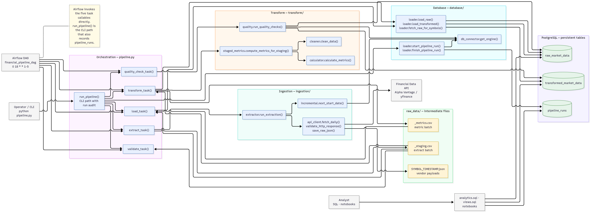

# 📈 Financial Market Data Pipeline

> **DEPI Graduation Project — Data Engineering Track**
> An automated, end-to-end pipeline that collects historical and live stock market data from a financial REST API, validates and transforms it, stores it in PostgreSQL, and schedules everything with Apache Airflow.

---

## 👥 Team

| Member | Name | Role
|--------|------|------
| A (Leader) | Ibrahim Sayed Muhammed | Infrastructure & Airflow Engineer
| B | Ali Khaled Fawzy Mansour | API & Data Ingestion Engineer
| C | Bavly Osam Geedy Arean | Database & SQL Analytics Engineer
| D | Emmanuel George Samy Riad | QA, Visualization & Documentation

---

## 🗂️ Project Structure

```
financial-market-data-pipeline/
│
├── ingestion/                   # Data extraction from API
│   ├── __init__.py
│   ├── api_client.py            # HTTP requests, validation, retry logic
│   ├── extractor.py             # Loops over stock symbols, calls api_client
│   └── incremental.py          # Tracks last loaded date per symbol
│
├── transform/                   # Data cleaning & financial calculations
│   ├── __init__.py
│   ├── cleaner.py               # Null handling, deduplication, type casting
│   ├── calculator.py            # Daily returns, moving averages, volume stats
│   ├── staged_metrics.py        # Metrics for the staging batch using stored history
│   └── quality.py               # Post-load database quality checks
│
├── database/                    # PostgreSQL interaction
│   ├── __init__.py
│   ├── db_connector.py         # SQLAlchemy engine (reads from .env)
│   ├── loader.py               # Inserts DataFrames into DB tables
│   ├── schema.sql              # CREATE TABLE scripts (run once)
│   ├── analytics.sql           # Analytical queries with window functions & CTEs
│   └── views.sql               # CREATE VIEW scripts
│
├── dags/                        # Apache Airflow DAG definition
│   └── financial_pipeline_dag.py
│
├── tests/                       # Unit tests (pytest)
│   ├── __init__.py
│   ├── test_api_client.py
│   ├── test_cleaner.py
│   ├── test_calculator.py
│   ├── test_config_validation.py
│   ├── test_extraction_pipeline_failure.py
│   └── test_staged_metrics.py
│
├── notebooks/                   # Jupyter notebooks (analysis & reporting)
│   ├── data_quality_report.ipynb
│   └── market_analysis.ipynb
│
├── utils/                       # Shared utilities
│   ├── __init__.py
│   └── logger.py               # Centralized logging setup
│
├── config/                      # Configuration
│   ├── __init__.py
│   └── settings.py             # Loads environment variables
│
├── raw_data/                    # Raw JSON files + batch staging/metrics CSVs
│   ├── _staging.csv             # Extract output (ephemeral)
│   ├── _metrics.csv             # Transform output (ephemeral)
│   └── .gitkeep
│
├── docs/                        # DEPI documentation (upload to GitHub)
│   ├── README.md                # Index + official due dates
│   ├── 01_project_proposal.md
│   ├── 02_project_plan.md
│   ├── 03_task_assignment_and_roles.md
│   ├── 04_risk_assessment.md
│   ├── 05_kpis.md
│   ├── 06_literature_review.md
│   ├── 07_requirements_gathering.md
│   ├── 08_system_analysis_and_design.md
│   ├── 09_api_research.md
│   └── diagrams/                # Mermaid sources + SVG/PNG exports
│       ├── *.mmd
│       └── exports/
│
├── pipeline.py                  # Five-task orchestration for CLI and Airflow
├── .env.example                 # Template for environment variables (safe to commit)
├── .gitignore
├── requirements.txt
├── docker-compose.yml           # Optional: containerized setup
└── README.md
```

---

## 🏗️ Architecture

The Airflow DAG runs five tasks in order: **extract → validate → transform → load → quality_check**.



Canonical source: [system-architecture.mmd](docs/diagrams/system-architecture.mmd) · [SVG export](docs/diagrams/exports/system-architecture.svg) · [Level-1 DFD](docs/diagrams/dfd-level-1.mmd) · [all diagram sources](docs/diagrams/README.md)

| Task | What it does | Output |
|------|--------------|--------|
| **Extract** | Reads the per-symbol watermark, fetches daily bars, validates the API HTTP response and payload, and saves the vendor JSON. | `raw_data/*.json` and `raw_data/_staging.csv` |
| **Validate** | Checks the staging CSV is non-empty, has the required OHLCV columns, and has no null `symbol` or `trade_date`. This is separate from API response validation. | Validated staging file |
| **Transform** | Combines staging with stored raw history, cleans the data, calculates metrics, and keeps only staging keys. It does not write to the database. | `raw_data/_metrics.csv` |
| **Load** | Inserts raw rows with `ON CONFLICT DO NOTHING` and upserts transformed metrics with `ON CONFLICT DO UPDATE`. | `raw_market_data` and `transformed_market_data` rows |
| **Quality Check** | Queries both tables for counts, duplicate raw keys, null closes, and orphan transformed rows. | Logged check counts; raises on duplicates or orphans |

If extraction reports no new data (every symbol returns an empty frame without error), `pipeline.extract_task()` returns `NO_NEW_DATA` and removes stale `_staging.csv` / `_metrics.csv` files. The `run_pipeline()` CLI path records the run as a success with zero rows and skips downstream tasks; Airflow still schedules the remaining tasks, which self-skip when the staging file is absent. Any symbol failure — including a partial failure — raises `ExtractionError`, so the run fails and no staging file is written; `fetch_yfinance()` treats an empty download as a symbol failure rather than no-new-data. See [docs/08_system_analysis_and_design.md](./docs/08_system_analysis_and_design.md#8-error-handling-policy) for the full policy.

---

## 🛠️ Tech Stack

| Layer | Technology |
|-------|-----------|
| Language | Python 3.10+ |
| Data Processing | Pandas, NumPy |
| Financial API | Alpha Vantage REST API + yfinance |
| Database | PostgreSQL 15 + SQLAlchemy + psycopg2 |
| Orchestration | Apache Airflow 2.x |
| Visualization | Matplotlib, Plotly |
| Testing | pytest |
| Version Control | Git + GitHub |
| Optional | Docker, Docker Compose, MongoDB |

---

## 📦 Installation & Setup

### 1. Clone the repository
```bash
git clone https://github.com/YOUR_USERNAME/financial-market-data-pipeline.git
cd financial-market-data-pipeline
```

### 2. Create a virtual environment
```bash
python -m venv venv
source venv/bin/activate        # Linux / macOS
venv\Scripts\activate           # Windows
```

### 3. Install dependencies
```bash
pip install -r requirements.txt
```

### 4. Configure environment variables
```bash
cp .env.example .env
# Open .env and fill in your values
```

### 5. Set up the PostgreSQL database
```bash
# Make sure PostgreSQL is running, then:
psql -U postgres -c "CREATE DATABASE financial_db;"
psql -U postgres -d financial_db -f database/schema.sql
psql -U postgres -d financial_db -f database/views.sql
```

### 6. Initialize Airflow
```bash
export AIRFLOW_HOME=$(pwd)/airflow_home
airflow db init
airflow users create \
    --username admin --password admin \
    --firstname Admin --lastname User \
    --role Admin --email admin@example.com
```

### 7. Start Airflow
```bash
airflow webserver --port 8080 &
airflow scheduler &
# Open http://localhost:8080 — login: admin / admin
```

---

## ▶️ Running the Pipeline Manually

```bash
# Run the full pipeline once (without Airflow)
python pipeline.py
```

Or trigger it from the Airflow UI under DAGs → `financial_pipeline_dag` → Trigger DAG ▶

---

## 📊 Tracked Stock Symbols

The pipeline collects data for the following symbols (configurable in `config/settings.py`):

```python
SYMBOLS = ["AAPL", "MSFT", "GOOGL", "AMZN", "META", "TSLA", "NVDA", "JPM"]
```

---

## 📐 Database Schema

### `raw_market_data`
| Column | Type | Description |
|--------|------|-------------|
| id | SERIAL PK | Auto-increment |
| symbol | VARCHAR(10) | Stock ticker (e.g. AAPL) |
| trade_date | DATE | Trading date |
| open_price | NUMERIC(12,4) | Opening price |
| high_price | NUMERIC(12,4) | Daily high |
| low_price | NUMERIC(12,4) | Daily low |
| close_price | NUMERIC(12,4) | Closing price |
| volume | BIGINT | Trading volume |
| loaded_at | TIMESTAMP | When this row was inserted |

### `transformed_market_data`
| Column | Type | Description |
|--------|------|-------------|
| id | SERIAL PK | Auto-increment |
| symbol | VARCHAR(10) | Stock ticker |
| trade_date | DATE | Trading date |
| close_price | NUMERIC(12,4) | Closing price |
| daily_return | NUMERIC(10,6) | % change from previous close |
| ma_7 | NUMERIC(12,4) | 7-day moving average |
| ma_20 | NUMERIC(12,4) | 20-day moving average |
| ma_50 | NUMERIC(12,4) | 50-day moving average |
| avg_volume_7d | NUMERIC(20,2) | 7-day average volume |
| volume_ratio | NUMERIC(10,4) | Today's volume / 7d avg |
| cumulative_return | NUMERIC(10,6) | Total return from first date |
| volatility_20d | NUMERIC(10,6) | 20-day rolling std of returns |

### `pipeline_runs`
| Column | Type | Description |
|--------|------|-------------|
| id | SERIAL PK | Auto-increment |
| run_date | TIMESTAMP | When the pipeline started |
| status | VARCHAR(20) | 'success' / 'failed' |
| symbols_processed | INTEGER | How many symbols were fetched |
| rows_inserted | INTEGER | How many rows were added |
| duration_seconds | NUMERIC | Total pipeline runtime |
| error_message | TEXT | Error detail if status = failed |

---

## 🧮 Financial Metrics Calculated

| Metric | Formula | Pandas Code |
|--------|---------|-------------|
| Daily Return | (close_t − close_t-1) / close_t-1 | `df['close'].pct_change()` |
| 7-day SMA | Mean of last 7 closes | `df['close'].rolling(7).mean()` |
| 20-day SMA | Mean of last 20 closes | `df['close'].rolling(20).mean()` |
| 50-day SMA | Mean of last 50 closes | `df['close'].rolling(50).mean()` |
| 20-day Volatility | Std dev of daily returns (20d) | `df['daily_return'].rolling(20).std()` |
| Volume Ratio | Volume / 7-day avg volume | `df['volume'] / df['volume'].rolling(7).mean()` |

---

## 🔬 Sample SQL Analytics Query

```sql
-- Top 3 best-performing days per symbol (using window function)
WITH ranked AS (
  SELECT
    symbol,
    trade_date,
    daily_return,
    close_price,
    RANK() OVER (PARTITION BY symbol ORDER BY daily_return DESC) AS return_rank
  FROM transformed_market_data
  WHERE trade_date >= CURRENT_DATE - INTERVAL '90 days'
)
SELECT symbol, trade_date, ROUND(daily_return * 100, 2) AS return_pct, close_price
FROM ranked
WHERE return_rank <= 3
ORDER BY symbol, return_rank;
```

---

## ✅ Running Tests

```bash
pytest tests/ -v
```

---

## 📁 Data Sources

| Source | Cost | API Key | Best For |
|--------|------|---------|---------|
| **yfinance** | Free, unlimited | ❌ Not needed | Development & testing |
| **Alpha Vantage** | Free (25 req/day) | ✅ Required | Official API requirement |
| **Polygon.io** | Free (5 req/min) | ✅ Required | Alternative to Alpha Vantage |

Get your free Alpha Vantage key at: https://www.alphavantage.co/support/#api-key

---

## 📚 Project documentation (DEPI)

Planning, literature review, and requirements are in [`docs/`](./docs/README.md). These files must stay on the **same** GitHub repository (the link cannot change).

| Document | File |
|----------|------|
| Proposal | [docs/01_project_proposal.md](./docs/01_project_proposal.md) |
| Plan / Gantt | [docs/02_project_plan.md](./docs/02_project_plan.md) |
| Roles | [docs/03_task_assignment_and_roles.md](./docs/03_task_assignment_and_roles.md) |
| Risks | [docs/04_risk_assessment.md](./docs/04_risk_assessment.md) |
| KPIs | [docs/05_kpis.md](./docs/05_kpis.md) |
| Literature review | [docs/06_literature_review.md](./docs/06_literature_review.md) |
| Requirements | [docs/07_requirements_gathering.md](./docs/07_requirements_gathering.md) |
| System analysis & design | [docs/08_system_analysis_and_design.md](./docs/08_system_analysis_and_design.md) |
| API research | [docs/09_api_research.md](./docs/09_api_research.md) |
| Diagram sources & exports | [docs/diagrams/README.md](./docs/diagrams/README.md) |

---

## 📷 Screenshots

> *(Add Airflow DAG run screenshot here after Week 9)*
> *(Add pgAdmin table data screenshot here)*
> *(Add visualization charts here)*

---

## 📄 License

This project is developed as a graduation project for the **Digital Egypt Pioneers Initiative (DEPI)** — Data Engineering Track.

---

## 🙏 Acknowledgements

- [Alpha Vantage](https://www.alphavantage.co/) for the financial data API
- [Apache Airflow](https://airflow.apache.org/) documentation
- [DEPI Program](https://depi.gov.eg/) for project guidance and mentorship
