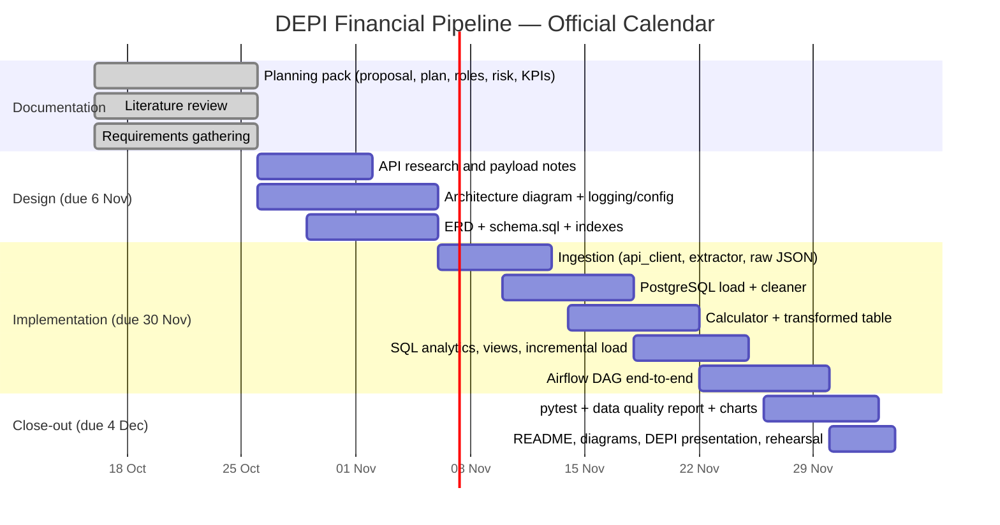

# Project Plan

**Project:** Automated Financial Market Data Pipeline
**Calendar:** 16 October 2026 → 4 December 2026 (DEPI official checkpoints)
**Internal method:** 8 technical phases mapped onto those dates

The internal 12-week playbook is compressed to match DEPI submission dates. Technical order does not change: setup → research → ingest → transform → SQL/incremental → Airflow → tests → presentation.

---

## 1. Timeline (Gantt)



---

## 2. Milestones and deliverables

| ID | Window | Lead | Deliverables | DEPI mapping |
|----|--------|------|--------------|--------------|
| M0 | Now (catch-up) | All | GitHub repo, team roles, `docs/` planning pack | Planning / literature / requirements (16 Oct) |
| M1 | 26 Oct – 6 Nov | A (+ B, C) | Architecture diagram, ERD, `schema.sql`, API research notes, `config/settings.py`, `utils/logger.py` | System Analysis & Design (6 Nov) |
| M2 | 6–13 Nov | B (+ C) | `api_client.py`, `extractor.py`, validated JSON → DataFrame, retries | Implementation |
| M3 | 10–18 Nov | C (+ B) | DB up, `db_connector.py`, `loader.py`, `raw_market_data` populated | Implementation |
| M4 | 14–22 Nov | C (+ B) | `cleaner.py`, `calculator.py`, `transformed_market_data` | Implementation |
| M5 | 18–25 Nov | C (+ D) | `analytics.sql`, `views.sql`, `incremental.py`, `pipeline_runs` | Implementation |
| M6 | 22–30 Nov | A (+ B) | `financial_pipeline_dag.py`, Airflow UI success screenshots | Implementation (30 Nov) |
| M7 | 26 Nov – 3 Dec | D (+ A) | pytest, quality notebook, Plotly/Matplotlib charts | Testing & reports (4 Dec) |
| M8 | 30 Nov – 4 Dec | D (all) | Final README, PDF report, DEPI PPT, ZIP, rehearsal | Final presentation (4 Dec) |

---

## 3. Resource allocation

| Person | Role | Typical weekly focus | Peak weeks |
|--------|------|----------------------|------------|
| Ibrahim Sayed Muhammed | Infra & Airflow (Leader) | Repo hygiene, architecture, Airflow, optional Docker, mentor communication | 26 Oct–6 Nov, 22–30 Nov |
| Ali Khaled Fawzy Mansour | API & ingestion | API keys, client, retries, wrapping functions for Airflow | 26 Oct–13 Nov, 22–30 Nov |
| Bavly Osam Geedy Arean | Database & SQL | Schema, PostgreSQL, loader, metrics, analytics SQL | 29 Oct–25 Nov |
| Emmanuel George Samy Riad | QA, viz & docs | `docs/`, tests, quality report, charts, DEPI slides | 26 Oct (docs), 26 Nov–4 Dec |

**Shared rules**

- Feature branches; pull requests into `main`; no secrets in Git.
- Push at least every two days when a module is in progress.
- Weekly 30-minute sync (leader tracks blockers).
- Every member must be able to explain the full pipeline in the final Q&A.

**Environment (everyone)**

Python 3.10+, Git, VS Code, PostgreSQL 15 (or access to a shared instance), Alpha Vantage key (free tier).

---

## 4. Branching strategy

```
main                 # always demo-able; protected by PR
  feature/ingestion
  feature/database
  feature/transform
  feature/airflow
  feature/docs
```

Commit messages describe **why** (example: `add retry backoff so Alpha Vantage 429s do not fail the DAG`).

---

## 5. Dependencies between workstreams

1. `settings.py` + `logger.py` before other Python modules.
2. `schema.sql` before `loader.py`.
3. Working extract before cleaner/calculator on real data.
4. Load + incremental logic before a meaningful Airflow DAG.
5. Stable tables before SQL analytics and quality report.

Optional extras (Docker, MongoDB raw store) start **only after** M6 is green.

---

## 6. Communication and tracking

| Channel | Use |
|---------|-----|
| GitHub repository (fixed URL) | Source of truth for code and documents |
| GitHub Projects / issues | Backlog → In progress → Review → Done |
| WhatsApp / Telegram | Daily pings, not decisions |
| Weekly sync | Status, blockers, next milestone |
| Mentor | Leader (Ibrahim) submits progress at each DEPI checkpoint |
