# System Analysis & Design

**Due (DEPI):** 6 November 2026
**Status:** Design complete — implementation in repository modules

**Diagram sources & exports:** canonical Mermaid sources live in [`docs/diagrams/`](./diagrams/), with rendered SVG/PNG files in [`docs/diagrams/exports/`](./diagrams/exports/). The diagrams embedded in this document are kept consistent with those standalone sources; see [`docs/diagrams/README.md`](./diagrams/README.md).

---

## 1. Problem statement & objectives

See [01_project_proposal.md](./01_project_proposal.md). In one sentence: analysts need a **repeatable, scheduled ETL pipeline** that turns messy vendor OHLCV JSON into queryable PostgreSQL tables with returns and moving averages.

**Architecture style:** batch ETL / data pipeline (not MVC, not microservices). Control plane = Apache Airflow. Data plane = Python (Pandas) + PostgreSQL.

**Data-source default:** `config/settings.py` sets `DATA_SOURCE` to **yfinance** when the environment variable is absent. yfinance is therefore the runtime default for development, tests, and any scheduled run that does not override the setting. **Alpha Vantage** is the supported official REST API path used for the DEPI “consume an API” requirement and demonstrations; it is not the default. The diagrams label the external entity as “Alpha Vantage / yfinance” to show both supported paths, not to imply that Alpha Vantage is the default. Only those two values are accepted by `SUPPORTED_DATA_SOURCES`; Polygon.io is not implemented. See [09_api_research.md](./09_api_research.md) for provider evidence and limitations.

---

## 2. Software architecture

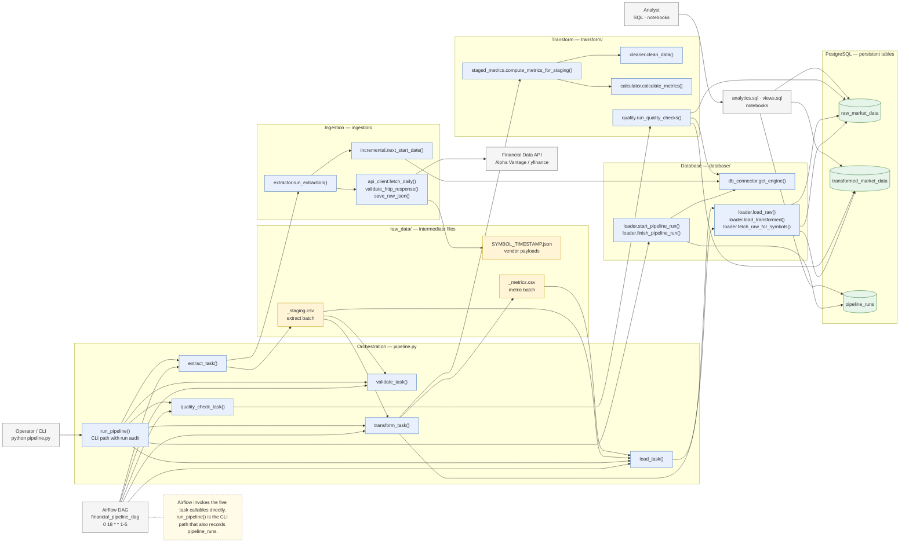

Extract writes the raw vendor JSON files and the batch staging file. Validate reads only the staging CSV. Transform reads the staging CSV and stored raw history, then writes `_metrics.csv`; it performs no database inserts. Load is the only task that writes raw and transformed records to PostgreSQL. Quality check then queries both tables.

`run_pipeline()` is the CLI orchestrator and is the only path that writes the `pipeline_runs` audit rows (through `database/loader.py`). The Airflow DAG imports the five task callables and invokes them directly, so Airflow owns task state and does not update `pipeline_runs`.

Modules:

| Package | Responsibility |
|---------|----------------|
| `config/` | Environment variables and validation helpers |
| `utils/` | Logging |
| `ingestion/` | HTTP/API client, response validation, symbol loop, watermarks |
| `transform/` | Cleaning, metrics calculation, staged metrics, quality queries |
| `database/` | Engine, schema, loader, pipeline-run audit helpers |
| `dags/` | Airflow graph |
| `pipeline.py` | Five tasks (`extract`, `validate`, `transform`, `load`, `quality_check`) used by the Airflow DAG, plus `run_pipeline` for direct CLI runs |

---

## 3. Use case diagram

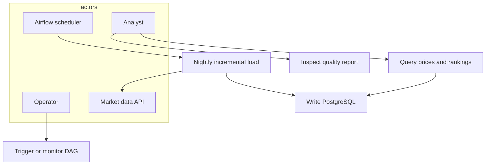

| Use case | Description |
|----------|-------------|
| UC-01 Nightly load | Scheduler runs extract → validate → transform → load → quality_check |
| UC-02 Manual run | Operator: `python pipeline.py` |
| UC-03 Rank query | Analyst runs window-function SQL |
| UC-04 Quality inspection | Notebook / `run_quality_checks()` |

---

## 4. Data flow (DFD)

**Context (level 0)**

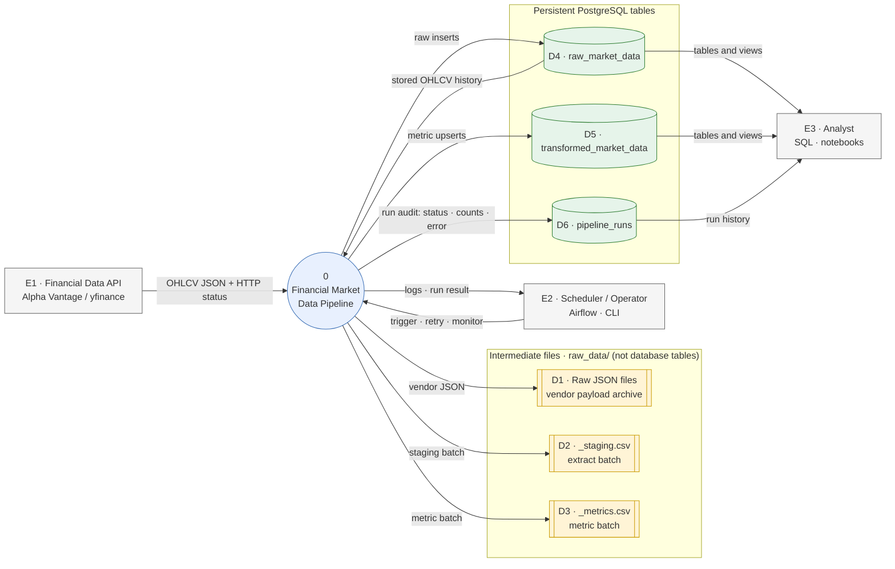

**Level 1**

```mermaid
flowchart LR
    E1["E1 · Financial Data API<br/>Alpha Vantage / yfinance"]
    E2["E2 · Scheduler / Operator<br/>Airflow · CLI"]
    E3["E3 · Analyst<br/>SQL · notebooks"]

    subgraph PROC["Processes"]
        P0(["P0 · Orchestrate & audit<br/>run_pipeline()"])
        P1(["P1 · Extract"])
        P2(["P2 · Validate"])
        P3(["P3 · Transform"])
        P4(["P4 · Load"])
        P5(["P5 · Quality Check"])
    end

    subgraph FILES["Intermediate files · raw_data/ (not database tables)"]
        D1[["D1 · Raw JSON files<br/>SYMBOL_UTC.json"]]
        D2[["D2 · _staging.csv<br/>batch OHLCV"]]
        D3[["D3 · _metrics.csv<br/>metric rows"]]
    end

    subgraph TABLES["Persistent PostgreSQL tables"]
        D4[("D4 · raw_market_data")]
        D5[("D5 · transformed_market_data")]
        D6[("D6 · pipeline_runs")]
    end

    E1 -->|"OHLCV daily bars + HTTP status"| P1
    E2 -->|"Airflow task trigger"| P1
    E2 -->|"CLI: python pipeline.py"| P0
    P0 -->|"start task chain (CLI)"| P1

    D4 -->|"MAX(trade_date) per-symbol watermark"| P1
    P1 -->|"vendor payload per symbol (write-only archive)"| D1
    P1 -->|"standardized staging batch"| D2

    D2 -->|"staging rows"| P2
    P2 -->|"validated staging path"| P3
    D2 -->|"staging rows"| P3
    D4 -->|"stored OHLCV history"| P3
    P3 -->|"metrics for staging keys"| D3

    D2 -->|"raw rows"| P4
    D3 -->|"metric rows"| P4
    P4 -->|"INSERT · ON CONFLICT DO NOTHING"| D4
    P4 -->|"UPSERT · ON CONFLICT DO UPDATE"| D5

    D4 -->|"row counts · duplicate keys · null closes"| P5
    D5 -->|"row counts · orphan keys"| P5
    P5 -->|"CLI: quality counts / error"| P0

    P1 -.->|"CLI: NO_NEW_DATA or ExtractionError"| P0
    P2 -.->|"CLI: validation ValueError"| P0
    P3 -.->|"CLI: transform exception"| P0
    P4 -.->|"CLI: load / database exception"| P0
    P0 -->|"CLI audit: status · counts · duration · error"| D6
    P0 -->|"run result / logs"| E2

    D4 -->|"price queries"| E3
    D5 -->|"metric queries"| E3
    D6 -->|"run history"| E3

    NOTE["CLI path: P0 invokes P1 → P2 → P3 → P4 → P5 in order and writes pipeline_runs.<br/>Airflow path: Scheduler/Operator triggers the five task callables directly; Airflow owns task state."]
    P0 -.- NOTE

    classDef external fill:#f5f5f5,stroke:#666,stroke-width:1px
    classDef process fill:#e8f0fe,stroke:#3b6fb6,stroke-width:1px
    classDef file fill:#fff4d6,stroke:#c99a00,stroke-width:1px
    classDef table fill:#e6f4ea,stroke:#2e7d32,stroke-width:1px
    classDef note fill:#fffbe6,stroke:#999,stroke-dasharray:3 3

    class E1,E2,E3 external
    class P0,P1,P2,P3,P4,P5 process
    class D1,D2,D3 file
    class D4,D5,D6 table
    class NOTE note
```

The Level-1 DFD numbers the five ETL processes P1–P5 and adds P0 for run orchestration/audit. P0 is only needed because `pipeline_runs` is written by `run_pipeline()` on the CLI path; the Airflow DAG triggers the task callables directly.

1. Extract reads the per-symbol watermark, fetches bars, validates the API HTTP response and payload, and saves the vendor JSON. `pipeline.extract_task()` — not `extractor.run_extraction()` — writes the batch to `raw_data/_staging.csv`.
2. Landing zone stores the vendor JSON returned by each completed API request (`<SYMBOL>_<UTC timestamp>.json`).
3. Validate reads `_staging.csv` and checks that it is non-empty, has the required OHLCV columns, and has no null `symbol` or `trade_date`. This is separate from the API response validation performed during extraction.
4. Transform combines the staging batch with stored raw history, cleans the data, calculates metrics, and writes only the staging keys to `raw_data/_metrics.csv`. It does not insert into PostgreSQL.
5. Load inserts raw rows into `raw_market_data` (`ON CONFLICT DO NOTHING`) and upserts metric rows into `transformed_market_data` (`ON CONFLICT DO UPDATE`).
6. Quality check queries both tables for row counts, duplicate raw keys, null closes, and transformed rows without a raw parent; duplicates or orphans raise an error.
7. If extraction reports no new data, `pipeline.extract_task()` removes stale `_staging.csv` and `_metrics.csv` files and returns `NO_NEW_DATA`; downstream tasks are skipped and the run is recorded as a success with zero rows.

**Intermediate files:** `raw_data/_staging.csv` (extract output, validate/transform/load input) and `raw_data/_metrics.csv` (transform output, load input). Both are batch files under `RAW_DATA_DIR`, not database tables. Raw JSON files are the write-only vendor landing archive. `raw_market_data`, `transformed_market_data`, and `pipeline_runs` are the persistent PostgreSQL tables.

---

## 5. Sequence — incremental weekday run

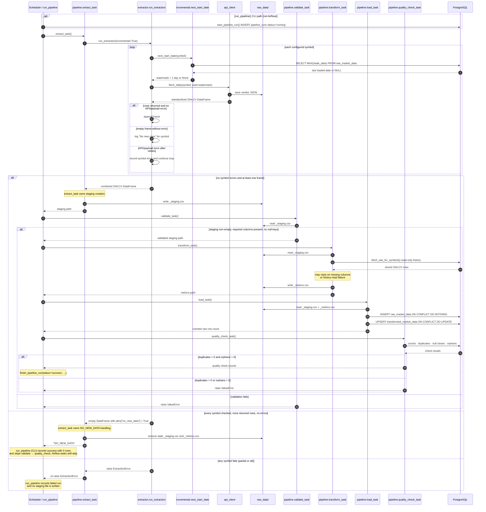

`pipeline.extract_task()` owns batch-file creation and removal: it writes `_staging.csv` on a successful extraction, removes stale `_staging.csv` and `_metrics.csv` on `NO_NEW_DATA`, and re-raises `ExtractionError`. `extractor.run_extraction()` only returns the combined DataFrame (with the `no_new_data` attribute when applicable) or raises. Transform only reads stored raw history in this flow; Load performs both database writes.

---

## 6. Activity — extraction and pipeline flow

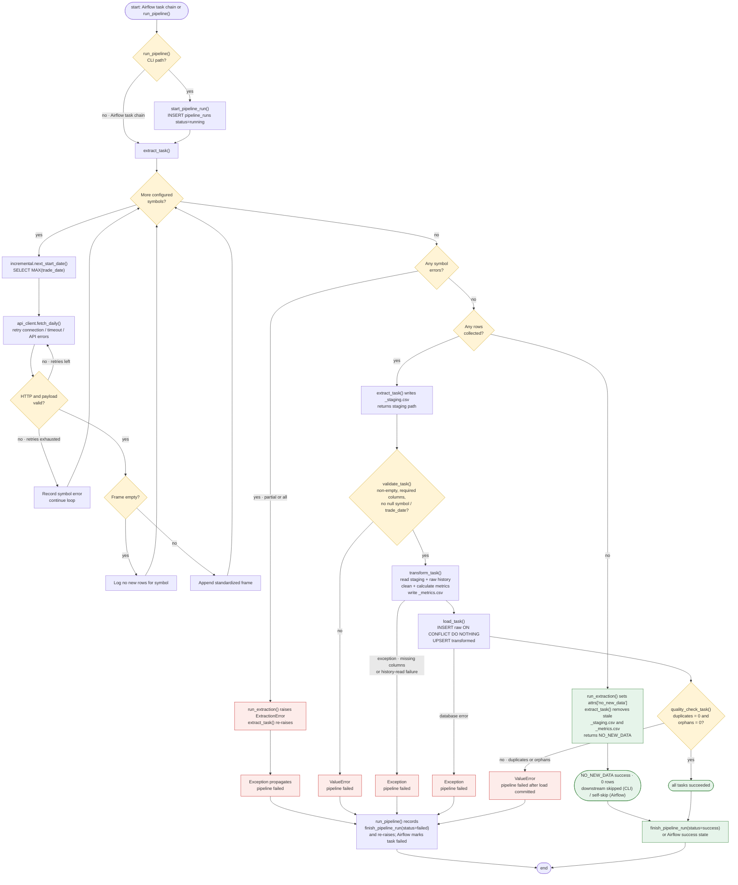

A partial symbol failure is not skipped: successful frames are discarded when `ExtractionError` is raised, and no staging file is written.

---

## 7. State diagram — `pipeline_runs.status`

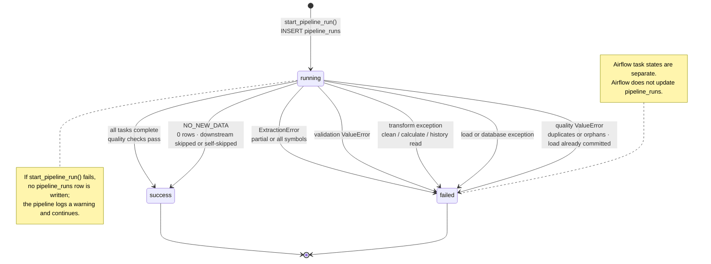

A transform exception (missing columns, calculation failure, or history-read failure) marks the run failed, just like extraction, validation, load/database, and quality-check errors. If `start_pipeline_run()` fails, the pipeline logs a warning and continues without a `pipeline_runs` row. Airflow task states (queued → running → success | up_for_retry → failed) are owned by Airflow, not our table.

---

## 8. Error-handling policy

The extractor treats any symbol failure as a run failure; it does not report partial success.

| Case | Actual behavior |
|------|-----------------|
| All symbols succeed (at least one row overall) | `run_extraction()` returns the combined OHLCV DataFrame; `extract_task()` writes `_staging.csv`; the pipeline continues to validate → transform → load → quality check. |
| Some symbols return rows, others return none (empty frame, no error) | `run_extraction()` logs "No new rows" for the empty symbols and returns the combined frames from the non-empty symbols. If there are no errors, extraction succeeds and the pipeline continues; this is not the all-symbols `NO_NEW_DATA` case. For yfinance, an empty download raises `APIClientError`, so it falls under partial or all-symbol failure instead. |
| Partial symbol failure | `run_extraction()` records failed symbols in `ExtractionError.errors` and successful ones in `symbols_ok`, then raises `ExtractionError`. Successful frames stay in memory only. `extract_task()` re-raises, so no `_staging.csv` is written and the successful symbols are not loaded. `run_pipeline()` records `pipeline_runs.status = 'failed'` and re-raises. |
| All symbols fail | `ExtractionError` is raised with an empty `symbols_ok`; the same failed-run behavior applies. |
| No new data | Occurs when every symbol's fetch returns an empty frame without raising and no errors occurred (for example, Alpha Vantage data filtered out by the incremental start date). `run_extraction()` then returns an empty DataFrame with `attrs["no_new_data"] = True`. `extract_task()` deletes stale `_staging.csv` and `_metrics.csv` and returns `"NO_NEW_DATA"`. `run_pipeline()` records `status = 'success'` with `symbols_processed = 0` and `rows_inserted = 0`, and skips validate, transform, load, and quality check. Note: `fetch_yfinance()` raises `APIClientError` for an empty download, so an up-to-date yfinance symbol is treated as a symbol failure, not `NO_NEW_DATA`. |
| Validation failure | `validate_task()` raises `ValueError` when staging is empty, required columns are missing, or `symbol` / `trade_date` is null. `run_pipeline()` records the failed run and re-raises. |
| Database / load failure | Exceptions from `load_task()` (engine/connection errors, constraint violations, and so on) propagate. `run_pipeline()` records the failed run and re-raises. `load_raw()` and `load_transformed()` each use their own transaction, so if the transformed upsert fails, raw rows committed by the same run may remain. |
| Quality-check failure | `run_quality_checks()` raises `ValueError` when `raw_duplicates > 0` or `orphan_transformed > 0`; null close counts are returned and logged but do not fail the run. `quality_check_task()` propagates the error, and `run_pipeline()` records the failed run and re-raises. Quality check runs after load, so rows written by that run remain committed even though the run is marked failed. |
| Pipeline-run audit write failure | A failure to insert the initial `pipeline_runs` row is logged as a warning and the pipeline continues without a run record. Failures to update the no-new-data and failure-state finish records are also best-effort warnings. A failure to update the normal success finish record is not wrapped locally, so it enters the outer exception handler, marks the run failed, and re-raises. |
| Incremental watermark lookup failure | Logged as a warning; extraction falls back to a full-history request for that symbol (`next_start_date()` returns `None`). |
| Rollback and pipeline-level retries (not implemented) | `run_pipeline()` has no automatic rollback or compensation after a quality-check failure, and no retry logic of its own; this is unspecified by the current code. Retries are owned by Airflow (`default_args`: `retries=3`, 5-minute delay) or by the caller. |

> `run_extraction()` retries individual API calls inside `api_client._retry_call()` (connection, timeout, and `APIClientError`), but after those retries are exhausted the symbol is recorded as failed and the extraction policy above applies.

> Downstream tasks also guard against a missing staging file: `validate_task()` and `transform_task()` return `"SKIP_NO_NEW_DATA"`, `load_task()` returns `0`, and `quality_check_task()` returns `{"status": "skipped_no_new_data"}`. `run_pipeline()` normally short-circuits before those tasks on `NO_NEW_DATA`.

> On extraction failure, vendor JSON files already written for successful symbols remain on disk, and any pre-existing `_staging.csv` is not deleted; the run simply stops before downstream tasks.

---

## 9. Component / class view

The implementation is module/function based; the only custom classes are the exception types.

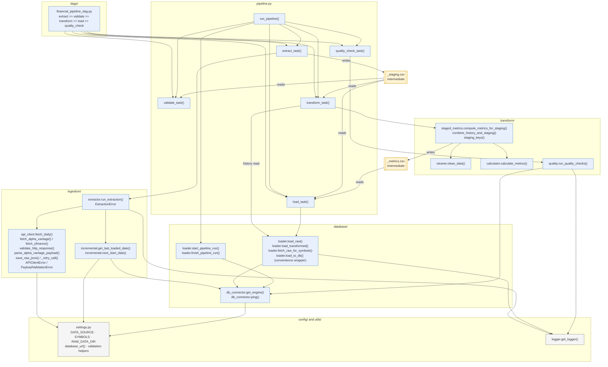

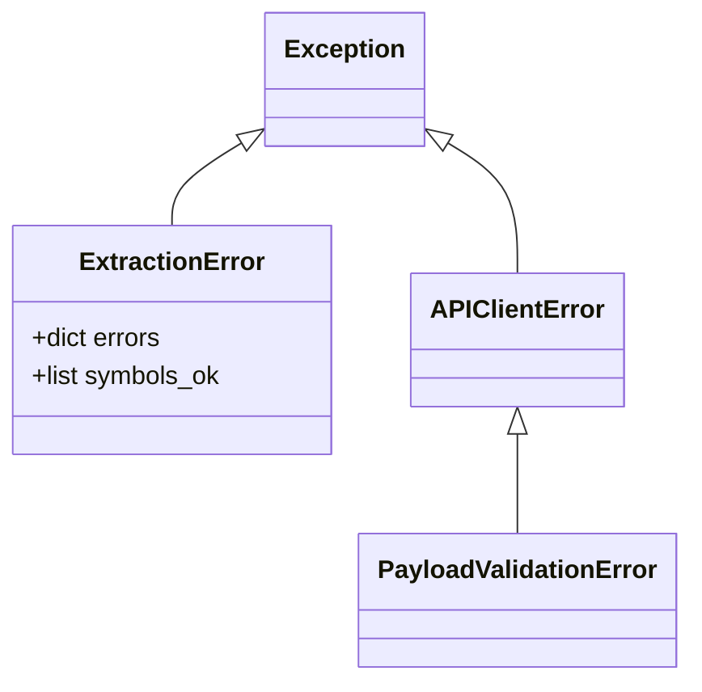

| Component | Key symbols | Responsibility |
|-----------|-------------|----------------|
| `config/settings.py` | `DATA_SOURCE`, `SYMBOLS`, `RAW_DATA_DIR`, `database_url()`, `validate_data_source()`, `require_database_config()`, `require_alpha_vantage_key()` | Environment configuration, source/DB/key validation |
| `utils/logger.py` | `get_logger()` | One root logger with stdout and `logs/pipeline.log` handlers |
| `ingestion/api_client.py` | `fetch_daily()`, `validate_http_response()`, `save_raw_json()`, `_retry_call()`, `parse_alpha_vantage_payload()`, `APIClientError`, `PayloadValidationError` | Source dispatch, HTTP/payload validation, retries, raw JSON persistence, column standardization |
| `ingestion/extractor.py` | `run_extraction()`, `ExtractionError` | Symbol loop, incremental start date, error collection, no-new-data result, failure policy |
| `ingestion/incremental.py` | `get_last_loaded_date()`, `next_start_date()` | High-watermark lookup from `raw_market_data`; full-history fallback on lookup failure |
| `transform/cleaner.py` | `clean_data()` | Rename/type-cast, forward-fill prices, deduplicate, drop unusable closes, sanitize volume |
| `transform/calculator.py` | `calculate_metrics()` | Daily return, SMA 7/20/50, average volume, volume ratio, cumulative return, volatility, max drawdown |
| `transform/staged_metrics.py` | `compute_metrics_for_staging()`, `combine_history_and_staging()` | Combine stored history with staging; return metric rows only for staging keys |
| `transform/quality.py` | `run_quality_checks()` | Post-load counts, duplicate and orphan checks; raises on duplicates/orphans |
| `database/db_connector.py` | `get_engine()`, `ping()` | Cached SQLAlchemy engine and DB configuration validation |
| `database/loader.py` | `load_raw()`, `load_transformed()`, `fetch_raw_for_symbols()`, `load_to_db()`, `start_pipeline_run()`, `finish_pipeline_run()` | Raw insert with conflict skip, transformed upsert, history read, pipeline-run audit |
| `pipeline.py` | `extract_task()`, `validate_task()`, `transform_task()`, `load_task()`, `quality_check_task()`, `run_pipeline()` | Task orchestration, staging/metrics files, NO_NEW_DATA, run audit |
| `dags/financial_pipeline_dag.py` | DAG definition | Weekday schedule and `extract >> validate >> transform >> load >> quality_check` dependency chain |

---

## 10. ERD (logical)

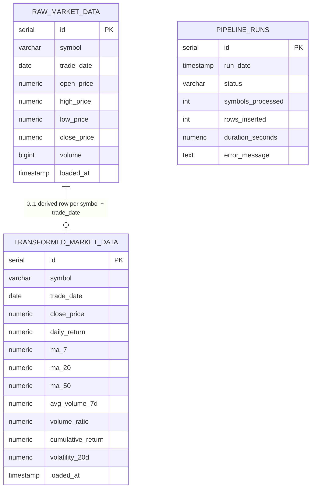

Physical DDL: [`database/schema.sql`](../database/schema.sql). Unique business key: `(symbol, trade_date)`. Composite indexes on `(symbol, trade_date)` and `(symbol, trade_date, close_price)`. `pipeline_runs` is an independent audit log with no foreign key to the fact tables.

**Normalization:** 3NF fact tables keyed by symbol and session date. Metrics are stored denormalized in `transformed_market_data` on purpose (warehouse fact grain = one session bar) so analysts do not recompute windows on every query.

---

## 11. Deployment / component diagram

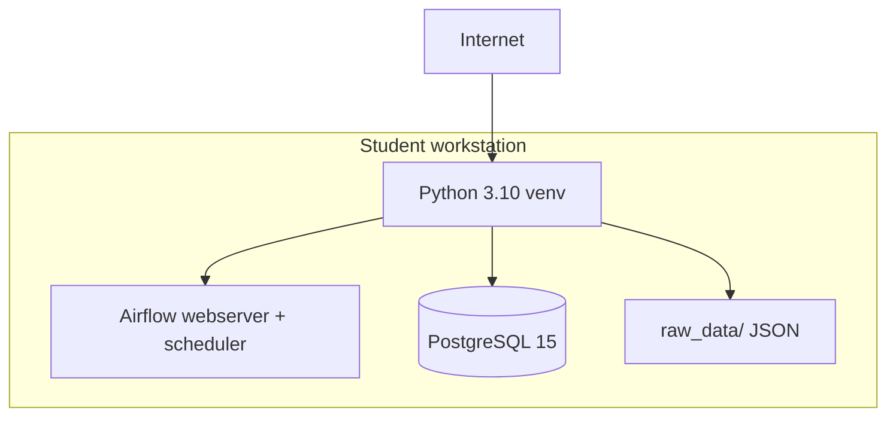

Optional later: Docker Compose with `pipeline` + `postgres` services. No public web UI is required. **Status:** planned/optional only — no `Dockerfile` or `docker-compose.yml` is present in the repository at this revision, so Docker is not part of the current implementation.

---

## 12. UI/UX

Not a product UI. Operator surfaces: Airflow (localhost:8080), pgAdmin or `psql`, Jupyter notebooks. No Figma mockups.

---

## 13. Testing & deployment notes

- Unit tests: `pytest tests/ -v` (no database required).
- Failure-path coverage: `tests/test_extraction_pipeline_failure.py` asserts all-symbol/partial `ExtractionError`, no-new-data success, and failed-run recording.
- Integration: create `financial_db`, apply `schema.sql` + `views.sql`, copy `.env.example` → `.env`, `python pipeline.py`.
- Secrets stay in `.env`. GitHub URL stays fixed.

---

## 14. Technology stack rationale

This section explains why each technology is used in this repository and separates **implemented** components from **configured/listed** or **planned** ones. “Implemented in code” means the module exists and is exercised by offline tests where noted; it does **not** mean a live database, Airflow deployment, or provider call has been verified in this repository. The current verification gap is summarised in §13 and in `DEPI_Project_Walkthrough_Report.md`.

| Technology | Why it is used here | Status | Evidence |
|------------|---------------------|--------|----------|
| **Python 3.10+** | One language for ingestion, cleaning, metric calculation, database loading, Airflow callables, and tests | Implemented | All application modules; `README.md`; `docs/07_requirements_gathering.md` NFR6. `requirements.txt` does not pin the interpreter. |
| **Pandas** | In-memory batch frames for parsing vendor payloads, standardising columns, cleaning, and rolling-window metrics | Implemented | `ingestion/api_client.py`, `ingestion/extractor.py`, `transform/*.py`, `database/loader.py`, `pipeline.py` |
| **NumPy** | Numerical dependency of Pandas; direct imports are limited to tests | Configured / transitive; not directly imported by application modules | `requirements.txt`; `tests/test_calculator.py`, `tests/test_staged_metrics.py` |
| **requests** | Direct HTTP `GET` for Alpha Vantage with explicit timeout and query parameters; avoids hiding the request/response contract behind another wrapper | Implemented | `ingestion/api_client.py` (`ALPHA_VANTAGE_URL`, `requests.get`, `validate_http_response`) |
| **python-dotenv** | Load `.env` without hard-coding secrets; supports local development and Airflow environment injection | Implemented | `config/settings.py` |
| **yfinance** | Runtime-default development source: no API key, pandas-native output, convenient backfills | Implemented | `ingestion/api_client.py` `fetch_yfinance()`; see [09_api_research.md](./09_api_research.md) §3 |
| **Alpha Vantage REST API** | Official API path for the DEPI requirement; documented daily OHLCV endpoint with a documented key/quota model | Implemented via `requests` | `ingestion/api_client.py` `fetch_alpha_vantage()`; `config/settings.py` `require_alpha_vantage_key()`; see [09_api_research.md](./09_api_research.md) §2 |
| **`alpha-vantage` Python package** | Listed as a dependency, but the application calls the REST endpoint directly with `requests` | Not used by application code | `requirements.txt`; no import in `ingestion/` |
| **SQLAlchemy 1.4.52** | Engine/connection management, parameterised SQL, transactions, and DataFrame reads; 1.4 is pinned because Airflow 2.8.1 requires it | Implemented | `database/db_connector.py`, `database/loader.py`, `ingestion/incremental.py`, `transform/quality.py`; `requirements.txt` comment |
| **psycopg2-binary** | PostgreSQL DBAPI driver selected by the `postgresql+psycopg2` SQLAlchemy URL | Implemented as the driver dependency | `config/settings.py` `database_url()`; `requirements.txt` |
| **PostgreSQL 15** | Persistent relational store: unique `(symbol, trade_date)` keys, `ON CONFLICT` inserts/upserts, audit table, and SQL window-function analytics | Implemented in code; runtime not verified here | `database/schema.sql`, `database/loader.py`, `database/analytics.sql`, `database/views.sql` |
| **Apache Airflow 2.8.1** | Control plane: weekday schedule, task dependencies, retries, and run visibility; the CLI path remains available for manual runs | Implemented in code; not verified running here | `dags/financial_pipeline_dag.py`, `pipeline.py`, `requirements.txt` |
| **pytest** | Offline unit tests for parsing, cleaning, metrics, configuration, and failure policy | Implemented | `tests/` |
| **Matplotlib / Plotly / Jupyter** | Planned visualization and reporting layer | Listed/planned; the `notebooks/` directory is currently empty | `requirements.txt`, `README.md` |
| **Docker / Docker Compose** | Optional packaging for a one-command local demo | Not implemented; no `Dockerfile` or `docker-compose.yml` in the repository | Repository tree; `README.md`; §11 |
| **MongoDB** | Optional alternative raw-JSON store | Not implemented; only a commented requirement | `requirements.txt` |

**Design rationale in one paragraph.** The workload is a small daily batch (eight default symbols), so Python + Pandas is sufficient; Spark or a distributed engine would add operational cost without a demonstrated need. PostgreSQL is chosen for transactional constraints, idempotent upserts, and SQL analytics rather than storing only flat files. SQLAlchemy + psycopg2 provide a parameterised database layer while keeping the schema explicit in `schema.sql`. Airflow supplies scheduling, retries, and task visibility; `pipeline.py` also supports a direct CLI run. yfinance is the convenience default for development, while Alpha Vantage is the official REST path that satisfies the DEPI API requirement. Neither provider is treated as unlimited or SLA-backed. Docker and MongoDB remain optional extensions and are not part of the current implementation.
