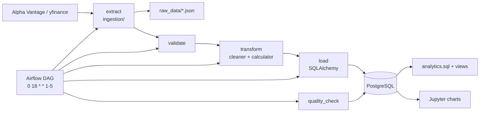
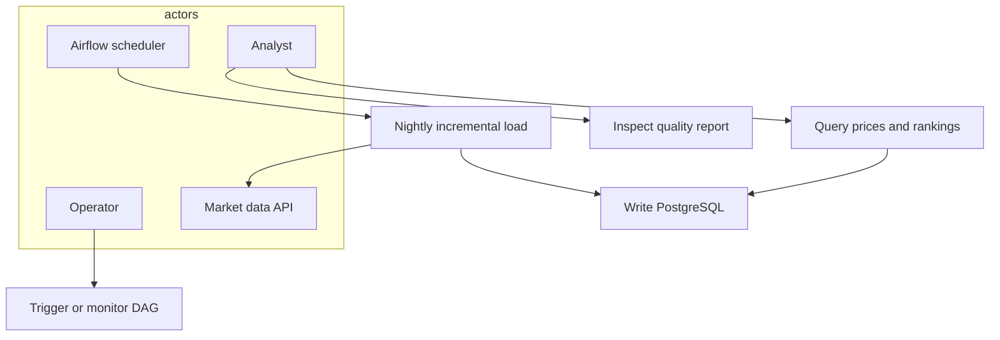
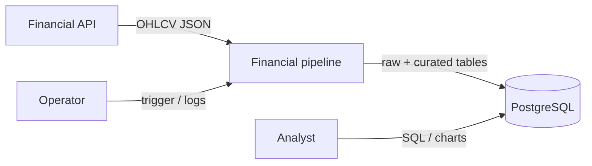
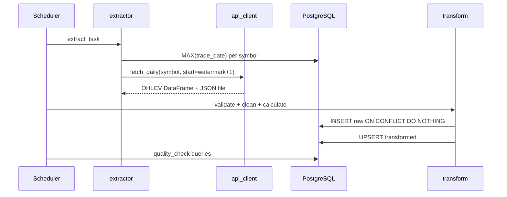
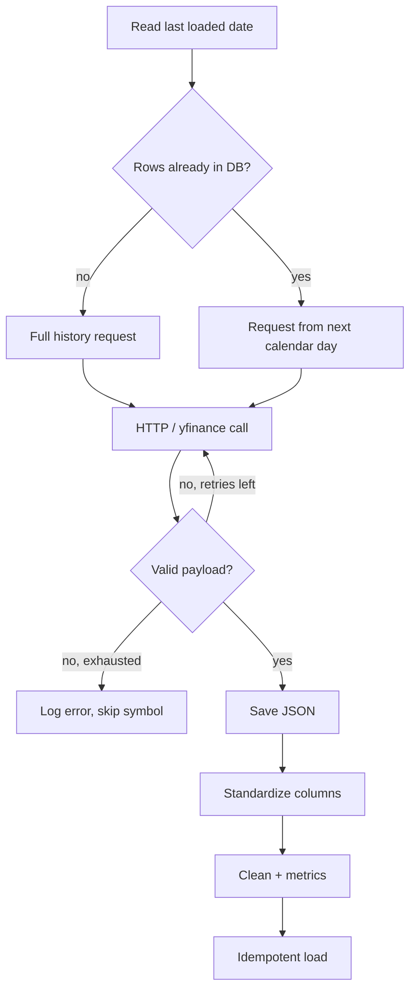
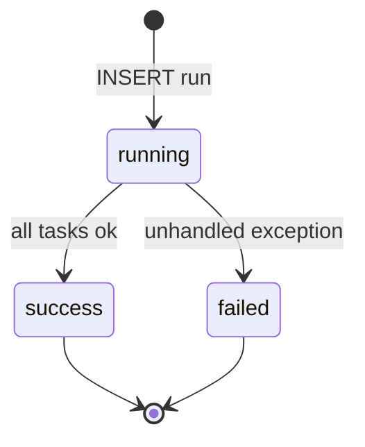
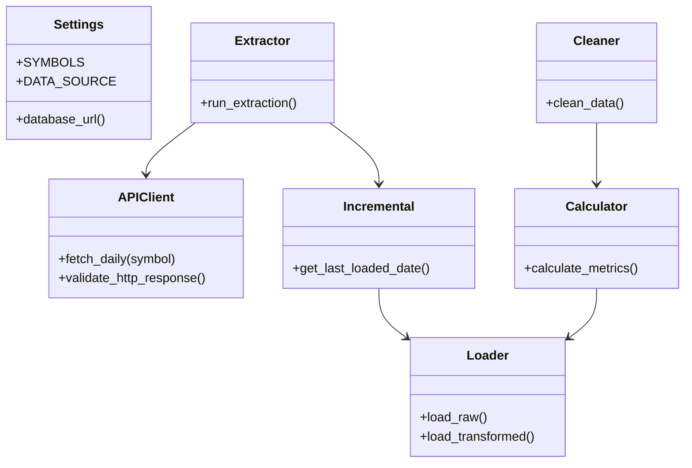
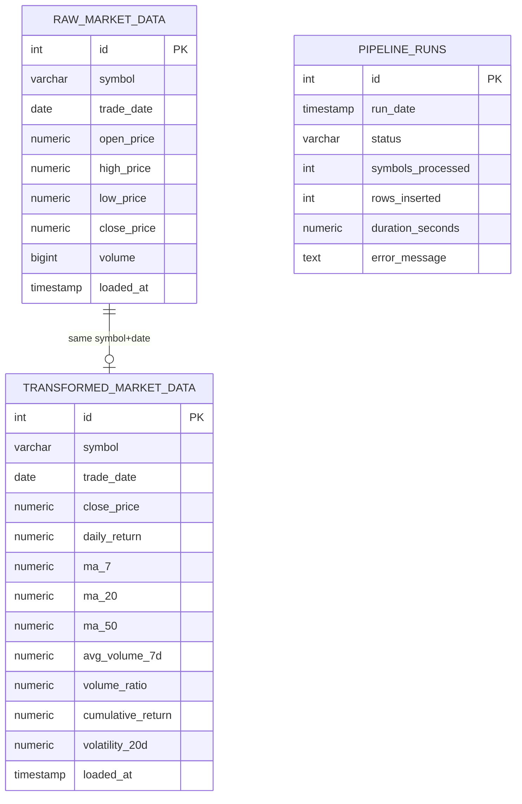
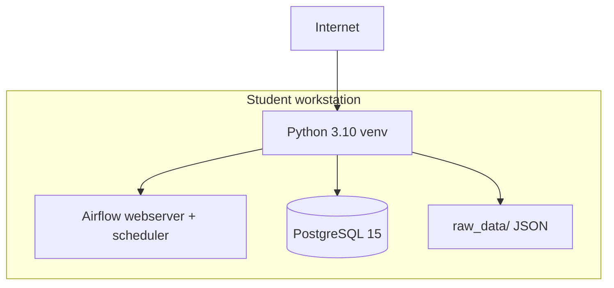

# System Analysis & Design

**Due (DEPI):** 6 November 2026
**Status:** Design complete — implementation in repository modules

---

## 1. Problem statement & objectives

See [01_project_proposal.md](./01_project_proposal.md). In one sentence: analysts need a **repeatable, scheduled ETL pipeline** that turns messy vendor OHLCV JSON into queryable PostgreSQL tables with returns and moving averages.

**Architecture style:** batch ETL / data pipeline (not MVC, not microservices). Control plane = Apache Airflow. Data plane = Python (Pandas) + PostgreSQL.

---

## 2. Software architecture

Modules:

| Package | Responsibility |
|---------|----------------|
| `config/` | Environment variables |
| `utils/` | Logging |
| `ingestion/` | HTTP/API, symbol loop, watermarks |
| `transform/` | Clean, metrics, quality queries |
| `database/` | Engine, schema, loader |
| `dags/` | Airflow graph |
| `pipeline.py` | Same five tasks for CLI and DAG |

---

## 3. Use case diagram

| Use case | Description |
|----------|-------------|
| UC-01 Nightly load | Scheduler runs extract → validate → transform → load → quality_check |
| UC-02 Manual run | Operator: `python pipeline.py` |
| UC-03 Rank query | Analyst runs window-function SQL |
| UC-04 Quality inspection | Notebook / `run_quality_checks()` |

---

## 4. Data flow (DFD)

**Context (level 0)**

**Level 1**

1. Extract pulls bars (incremental watermark).
2. Landing zone stores vendor JSON.
3. Validate checks columns and keys.
4. Transform cleans and computes metrics.
5. Load upserts PostgreSQL.
6. Quality check counts nulls, duplicates, orphans.

---

## 5. Sequence — incremental weekday run

---

## 6. Activity — one symbol

---

## 7. State diagram — `pipeline_runs.status`

Airflow task states (queued → running → success | up_for_retry → failed) are owned by Airflow, not our table.

---

## 8. Class / component view

---

## 9. ERD (logical)

Physical DDL: [`database/schema.sql`](../database/schema.sql). Unique business key: `(symbol, trade_date)`. Composite indexes on `(symbol, trade_date)` and `(symbol, trade_date, close_price)`.

**Normalization:** 3NF fact tables keyed by symbol and session date. Metrics are stored denormalized in `transformed_market_data` on purpose (warehouse fact grain = one session bar) so analysts do not recompute windows on every query.

---

## 10. Deployment / component diagram

Optional later: Docker Compose with `pipeline` + `postgres` services. No public web UI is required.

---

## 11. UI/UX

Not a product UI. Operator surfaces: Airflow (localhost:8080), pgAdmin or `psql`, Jupyter notebooks. No Figma mockups.

---

## 12. Testing & deployment notes

- Unit tests: `pytest tests/ -v` (no database required).
- Integration: create `financial_db`, apply `schema.sql` + `views.sql`, copy `env.example` → `.env`, `python pipeline.py`.
- Secrets stay in `.env`. GitHub URL stays fixed.
